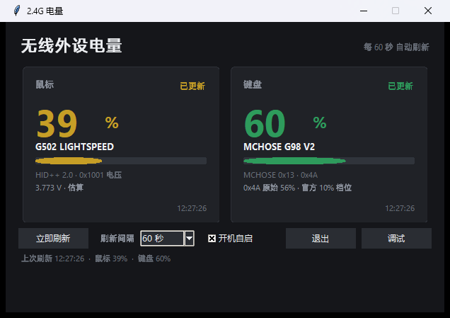
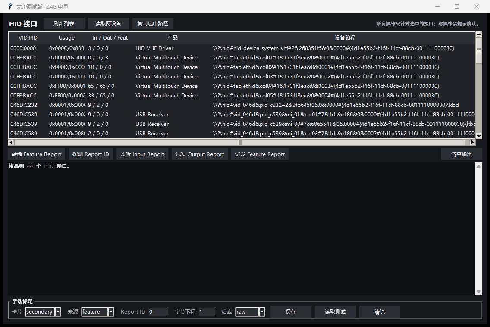

# 2.4G Battery Tray

Windows 10/11 的 2.4G 无线外设电量托盘工具。**纯 Python 标准库 + `ctypes` + `tkinter`**，没有 hidapi、pysystray、Pillow、pywin32 等第三方依赖，不写任何日志文件。

- 简洁面板：两张设备卡片，大号百分比、电量条、数据来源、更新时间
- 托盘常驻：每台设备一个电量数字图标，左键刷新、右键打开面板
- 完整调试版：HID 枚举、Feature 转储、Report ID 探测、Input 监听、试发报文、手动标定
- 开机自启：启动文件夹 `.lnk`，任务管理器可直接启用/禁用
- 低 CPU：Win32 `SetTimer` + 阻塞消息循环，空闲不轮询



## 支持的设备

当前重点适配并实机验证：

| 设备 | 接收器 VID:PID | 协议 |
| --- | --- | --- |
| Logitech G502 LIGHTSPEED | `046D:C539` | HID++ 2.0，`0x1001` 电压 |
| MCHOSE G98 V2 | `41E4:2004` | Sinowealth `0x13`，`0x4A` 电量应答 |

同时实现：

- ATK / VXE Nordic 鼠标：usage page `0xFF05`，Report `0x08`
- DARKRIM 耳机（杰理 JL_RCSP）：VID `0x3654`，65 字节报文
- 标准 HID Battery Strength（`0x0006/0x0020`）
- 调试版手动标定（Feature / Input、Report ID、字节下标、倍率）

## 环境要求

- Windows 10 / 11 x64
- Python 3.10+
- Python 安装时勾选 **tcl/tk**（python.org 默认包含）
- 无第三方依赖

## 快速开始

```bat
git clone https://github.com/laomo6/2.4G-Battery-Tray.git
cd 2.4g-battery-tray
python my_devices.py
```

默认打开面板并常驻托盘。只读一次：

```bat
python my_devices.py --once
```

`--once` 会打印两行，例如：

```text
鼠标 G502 LIGHTSPEED：39%（3.773 V · 估算） · HID++ 2.0 · 0x1001 电压
键盘 MCHOSE G98 V2：60%（0x4A 原始 55% · 官方 10% 档位） · MCHOSE 0x13 · 0x4A
```

## 常用命令

```bat
python my_devices.py              :: 面板 + 托盘
python my_devices.py --tray       :: 只常驻托盘
python my_devices.py --panel      :: 只开面板
python my_devices.py --debug      :: 完整调试版 + 控制台输出
python my_devices.py --list       :: 列出所有 HID 接口
python my_devices.py --once       :: 读一次并打印两行
python my_devices.py --install    :: 创建开机自启 + 桌面链接
python my_devices.py --uninstall  :: 删除本工具创建的启动项/桌面链接
```

`pythonw my_devices.py` 启动时不会弹控制台窗口。

## 开机自启与桌面入口

执行：

```bat
python my_devices.py --install
```

会创建：

1. `%APPDATA%\Microsoft\Windows\Start Menu\Programs\Startup\电量托盘.lnk`
   - 目标：`...\pythonw.exe "<项目路径>\my_devices.py" --tray`
   - 任务管理器 →「启动」标签可直接看到、启用或禁用
2. 桌面目录链接 `2.4G电量`
   - 优先符号链接，权限不足时降级 junction
3. 桌面启动文件链接
   - 优先文件符号链接，其次硬链接；跨盘且无符号链接权限时降级为 `.lnk`
   - 不复制脚本

「开机自启」勾选框读取任务管理器的真实状态：

```text
HKCU\Software\Microsoft\Windows\CurrentVersion\Explorer\StartupApproved\StartupFolder
```

`02` 开头为启用，`03` 开头为禁用。程序不会因为一次状态不一致就替用户删/建启动项。

> `启动.bat` 和 `启动.vbs` 是 `--install` 在本机生成的启动器，已加入 `.gitignore`，不会提交到仓库。

## 托盘与面板

- **左键托盘图标**：立刻刷新一次
- **右键托盘图标**：打开或前置面板；已打开不会重复开
- **悬停**：`设备名：电量（更新时间）`
- **关闭面板**：有托盘时只隐藏；无托盘时退出
- **退出按钮**：停止定时器、删除两个图标、`DestroyWindow`、`PostQuitMessage(0)`，进程真正退出
- **单实例**：命名互斥量，重复启动会唤醒已有面板

托盘图标由 GDI 现场绘制（圆角底色 + 电量数字），按系统 DPI 生成 32/48/64 px；只 `NIM_MODIFY`，不删了再加；Explorer 重启后重新 `NIM_ADD`。

## 协议细节

### Logitech G502 LIGHTSPEED（`046D:C539`）

- 厂商集合 usage page `0xFF00`，20 字节 HID++ 2.0 长报文 `0x11`
- 设备索引通常为 `1`
- 根特性 `0x0000` 查询特性索引
- `0x1001` Battery Voltage：大端毫伏值，例如 `0x0F71 = 3953 mV`
- `0x1000` / `0x1004` 在这台 G502 上不支持
- 百分比按 Solaar 的 Logitech LiPo 曲线 + `0.4` 校准估算：
  - `3.773 V ≈ 39%`
  - `3.956 V ≈ 75%`
  - `3.960 V ≈ 76%`
- 鼠标休眠时接收器不转发请求，程序保留上次电量并提示「动一下鼠标」

### MCHOSE G98 V2（`41E4:2004`）

- Sinowealth 无线键盘，20 字节 `0x13` 报文
- 查询电量：`13 4A 01 00 ...`，校验为前 19 字节和
- 直接应答 `13 4A 01 00 02 <raw> ...`：
  - `0x02` 是状态
  - 电量在 byte 5，例如 `0x14 = 20%`、`0x38 = 56%`
- 官方 HUB 按 **10% 档位四舍五入**显示：
  - raw 44 → 40%
  - raw 50 → 50%
  - raw 56 → 60%
  - raw 20 → 20%
- 详情里保留「原始 56%」便于核对
- 同时兼容主动上报的 `0x0A / 0x05` 通知：
  `13 0A 01 00 04 05 <level> <flags> ...`
- 休眠/关机/有线充电时可能不返回有效电量，按一下键盘或拔掉充电线后刷新

### ATK / VXE Nordic 鼠标

- usage page `0xFF05`，输入/输出 64 字节，无 Feature Report
- Report ID `0x08`，请求：

  ```text
  08 7D 72 02 00 01 07 01 00 ... 00
  ```

- 回复校验 `resp[1] == 0x72 && resp[5] == 0x07`，电量 `resp[7]`
- 无回复时提示「鼠标休眠，动一下鼠标」

### DARKRIM 耳机（JL_RCSP）

- VID `0x3654`，65 字节报文，无 Report ID
- 帧头：`00 FE <seq> <10|11> 00 <02|03> <frag> <more> <len_LE16>`
- 查询 TLV `0x01` 长度 0；回复 TLV `0x01` 第一个字节即电量
- CRC16-CCITT-FALSE（poly `0x1021`, init `0xFFFF`），覆盖 `帧[1:10+len]`，大端放 `帧[10+len]`、`帧[11+len]`
- 支持 TLV `0x02` 设备名、`0x04`/`0x05` 固件字符串

### 兜底

- 标准 HID Battery Strength（`0x0006/0x0020`）
- 手动标定：选择接口、Feature/Input、Report ID、字节下标、倍率（raw/255/200）

## 调试版

```bat
python my_devices.py --debug
```



- HID 接口表：VID:PID、usage、In/Out/Feat 长度、产品名、设备路径
- Feature Report 转储（Report ID 0–32）
- Report ID 探测（Feature 扫描 0–255 + Input 监听）
- Input Report 监听
- 试发 Output / Feature Report（发送前确认）
- 手动标定保存、读取测试、清除

调试输出只在控制台和调试窗口，不落盘。

## 实现要点

- **不要在同一个 HID 句柄上「阻塞 ReadFile + 并发 WriteFile/IOCTL」**：读句柄单独使用 `FILE_FLAG_OVERLAPPED` + 事件超时 + `CancelIoEx`
- 系统独占的顶层集合（鼠标/键盘/触摸屏）只用 `dwDesiredAccess=0` 打开，读取属性和 Feature Report
- 销毁托盘窗口时在 `WM_DESTROY` 里 `PostQuitMessage(0)`，避免留下无窗口僵尸进程
- Tkinter 非线程安全：后台线程只写 `queue.Queue`，主线程 `after()` 取出更新
- 托盘图标不 `NIM_DELETE` 后再 `NIM_MODIFY`；更新用 `NIM_MODIFY`，缺失时重新 `NIM_ADD`
- 启动 `SetProcessDPIAware`，托盘图标按 DPI 生成
- `.lnk` 纯 ctypes COM 创建：`CoCreateInstance(CLSID_ShellLink)` → `IShellLinkW` → `IPersistFile.Save`
- 开机自启只读 `StartupApproved` 状态，不自动纠正用户设置
- 不写日志，`--debug` 才输出控制台

## 项目结构

```text
.
├─ my_devices.py           # 主入口 / CLI / 单实例
├─ battery_tool/
│  ├─ hid.py               # SetupAPI + HID 枚举 + 安全读写
│  ├─ protocols.py         # Logitech / MCHOSE / ATK / DARKRIM / 标定
│  ├─ devices.py           # 两卡片设备选择与并发读取
│  ├─ tray.py              # 托盘线程、SetTimer、图标、退出
│  ├─ ui.py                # 简洁面板
│  ├─ debug_ui.py          # 完整调试版
│  ├─ icons.py             # GDI 电量图标
│  ├─ install.py           # .lnk / 启动项 / 桌面链接
│  ├─ config.py            # JSON 配置
│  └─ app.py               # Tk 主线程调度
├─ docs/
│  ├─ panel.png
│  └─ debug.png
├─ README.md
├─ LICENSE
├─ CHANGELOG.md
├─ requirements.txt
└─ .gitignore
```

## 已知限制

- G502 只暴露电压，没有直接百分比；百分比是电压曲线估算，来源会注明「电压 · 估算」
- MCHOSE 直接应答的 raw 值与官方 HUB 的 10% 档位不完全一致，程序按官方档位显示，详情保留 raw
- 无线外设休眠、关机或充电时可能不上报电量，需要按一下设备或拔掉充电线
- 厂商协议可能随固件变化；换设备时用调试版转储/标定
- 新托盘图标可能先进入任务栏「隐藏的图标」溢出区
- 仅支持 Windows；不是跨平台工具

## 测试记录

- `python my_devices.py --once`：两行电量正常输出
- 连续启停托盘 3 次：进程退出、托盘窗口销毁、无残留
- 空闲 75 秒 CPU 增量：约 0.03 秒
- 任务管理器「启动」：`电量托盘`，启用/禁用状态与面板勾选框一致
- 桌面：目录链接 + 启动文件链接均创建成功
- 项目目录无 `.log` 文件

## 免责声明

本项目是个人使用的第三方工具，**与 Logitech、MCHOSE、ATK、VXE、DARKRIM 及其关联公司无隶属关系**。协议来自对公开资料和本机设备的只读分析，可能随固件更新失效；使用风险自负。

## License

[MIT](LICENSE)
